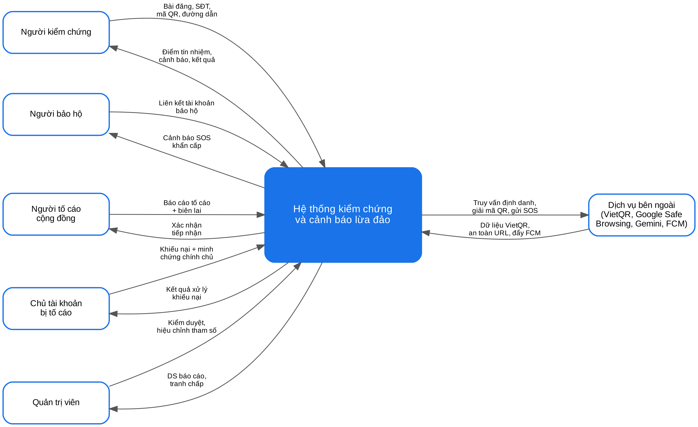
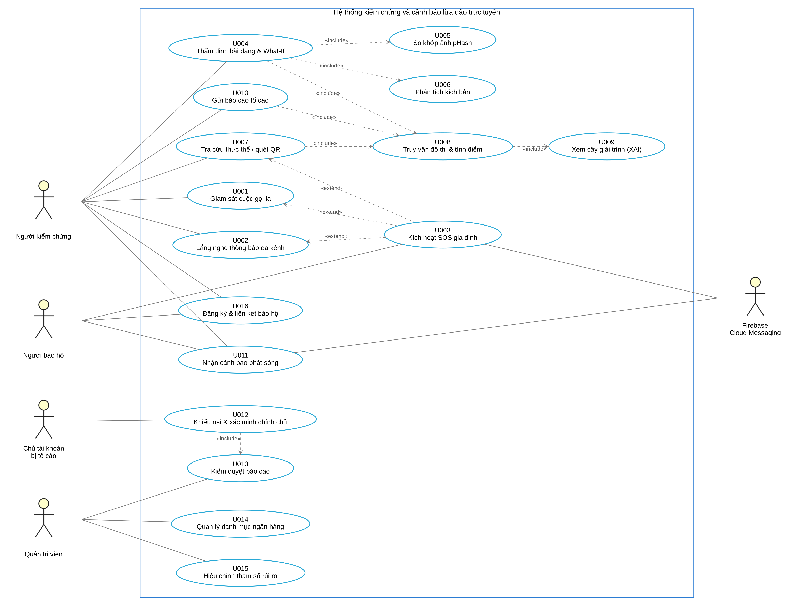
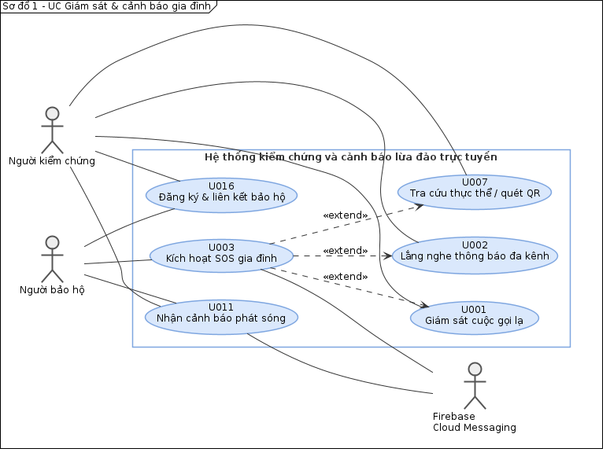
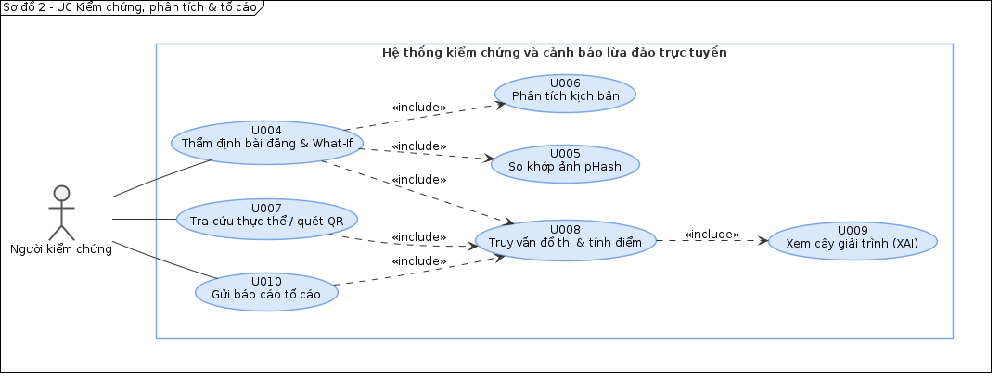
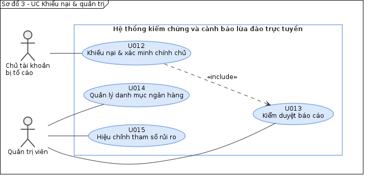
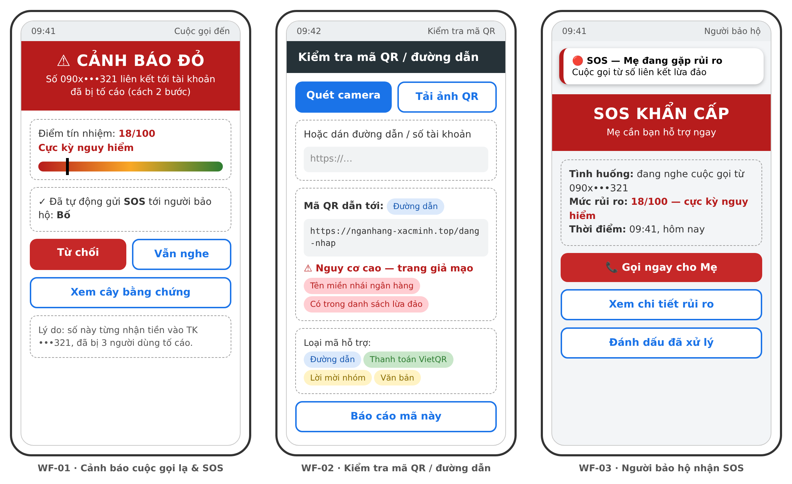
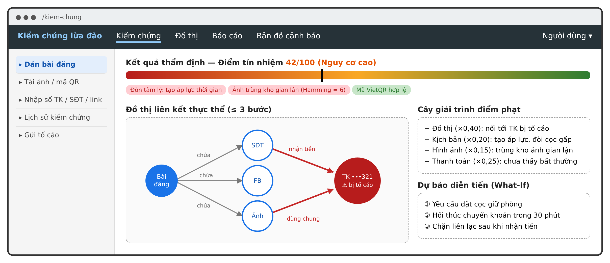
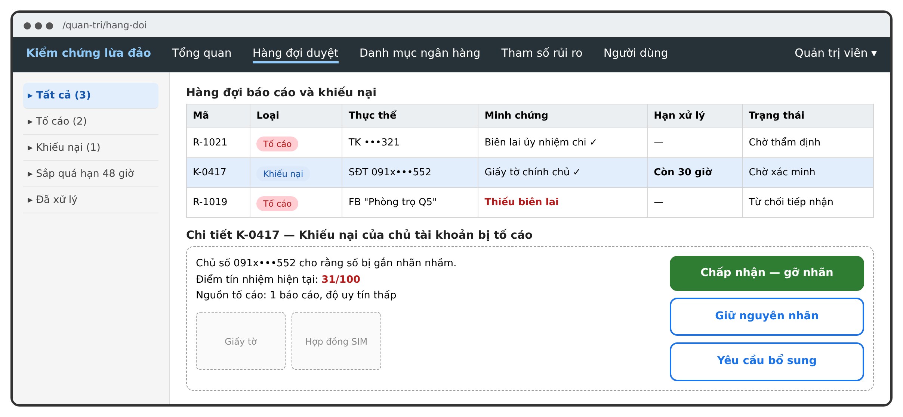

**ĐẠI HỌC QUỐC GIA THÀNH PHỐ HỒ CHÍ MINH**  
**TRƯỜNG ĐẠI HỌC KHOA HỌC TỰ NHIÊN**  
KHOA CÔNG NGHỆ THÔNG TIN — BỘ MÔN CÔNG NGHỆ PHẦN MỀM  

---

**NHẬP MÔN CÔNG NGHỆ PHẦN MỀM**

# BÁO CÁO PHÂN TÍCH YÊU CẦU

### HỆ THỐNG KIỂM CHỨNG VÀ CẢNH BÁO LỪA ĐẢO TRỰC TUYẾN

| | |
|---:|:---|
| **Môn học** | Nhập môn Công nghệ Phần mềm |
| **Lớp học phần** | 24_31 |
| **Nhóm thực hiện** | Nhóm 3 |
| **Giảng viên hướng dẫn** | ThS. Ngô Ngọc Đăng Khoa |
| **Thành viên thực hiện** | Đặng Quang Tiến (24120149) Hoàng Khang (24120334) Trương Bảo Nguyên (24120397) Sỉn Thăng Quyền (24120425) |

*Thành phố Hồ Chí Minh, ngày 07 tháng 11 năm 2026*

---

## MỤC LỤC

- [Danh mục hình ảnh](#danh-muc-hinh-anh)
- [Danh mục bảng biểu](#danh-muc-bang-bieu)
- [1. Bảng đánh giá thành viên](#1-bang-danh-gia-thanh-vien)
- [2. Mô tả bài toán](#2-mo-ta-bai-toan)
    - [2.1. Môi trường hoạt động](#21-moi-truong-hoat-dong)
    - [2.2. Công nghệ và mô hình xử lý](#22-cong-nghe-va-mo-hinh-xu-ly)
    - [2.3. Ràng buộc thiết kế và triển khai](#23-rang-buoc-thiet-ke-va-trien-khai)
- [3. Tổng quan yêu cầu](#3-tong-quan-yeu-cau)
    - [3.1. Danh sách các Stakeholder](#31-danh-sach-cac-stakeholder)
    - [3.2. Đặc tả yêu cầu chức năng](#32-dac-ta-yeu-cau-chuc-nang)
    - [3.3. Công thức tính điểm tín nhiệm](#33-cong-thuc-tinh-diem-tin-nhiem)
    - [3.4. Đặc tả yêu cầu phi chức năng](#34-dac-ta-yeu-cau-phi-chuc-nang)
- [4. Đặc tả yêu cầu](#4-dac-ta-yeu-cau)
    - [4.1. Sơ đồ Use Case](#41-so-do-use-case)
    - [4.2. Đặc tả Use Case](#42-dac-ta-use-case)
        - [4.2.1. U001 — Giám sát cuộc gọi lạ](#421-u001-giam-sat-cuoc-goi-la)
        - [4.2.2. U003 — Kích hoạt cảnh báo SOS gia đình](#422-u003-kich-hoat-canh-bao-sos-gia-dinh)
        - [4.2.3. U004 — Thẩm định bài đăng và mô phỏng What-If](#423-u004-tham-dinh-bai-dang-va-mo-phong-what-if)
        - [4.2.4. U008 — Truy vấn đồ thị và tính điểm tín nhiệm](#424-u008-truy-van-do-thi-va-tinh-diem-tin-nhiem)
        - [4.2.5. U010 — Gửi báo cáo tố cáo kèm biên lai](#425-u010-gui-bao-cao-to-cao-kem-bien-lai)
        - [4.2.6. U012 — Gửi khiếu nại và xác minh chính chủ](#426-u012-gui-khieu-nai-va-xac-minh-chinh-chu)
- [5. Bản mẫu](#5-ban-mau)
    - [5.1. Ứng dụng di động Android](#51-ung-dung-di-dong-android)
    - [5.2. Ứng dụng web](#52-ung-dung-web)

---

## DANH MỤC HÌNH ẢNH

- [Hình 1 — Context Diagram: Luồng dữ liệu giữa hệ thống và các stakeholder](#hinh-1)
- [Hình 2 — Sơ đồ Use Case tổng quát của hệ thống SmartGuard](#hinh-2)
- [Hình 3 — Sơ đồ Use Case 1: Giám sát ngoại vi và Bảo hộ khẩn cấp](#hinh-3)
- [Hình 4 — Sơ đồ Use Case 2: Thẩm định đa kênh và Đồ thị tri thức XAI](#hinh-4)
- [Hình 5 — Sơ đồ Use Case 3: Cơ chế phản biện, khiếu nại và Quản trị hệ thống](#hinh-5)
- [Hình 6 — Wireframe ứng dụng di động: Giám sát cuộc gọi số lạ và Tra cứu nhanh VietQR](#hinh-6)
- [Hình 7 — Wireframe ứng dụng Web: Thẩm định bài đăng và Trực quan hóa đồ thị](#hinh-7)
- [Hình 8 — Wireframe ứng dụng Web Quản trị: Kiểm duyệt chứng từ và Báo cáo vi phạm](#hinh-8)

---

## DANH MỤC BẢNG BIỂU

- [Bảng 1 — Bảng đánh giá thành viên và mức độ đóng góp](#bang-1)
- [Bảng 2 — Danh sách các Stakeholder chính của hệ thống SmartGuard](#bang-2)
- [Bảng 3 — Danh mục 27 yêu cầu chức năng (User Story — Requirement — Details)](#bang-3)
- [Bảng 4 — Đặc tả chi tiết Use Case U001: Giám sát cuộc gọi lạ thời gian thực](#bang-4)
- [Bảng 5 — Đặc tả chi tiết Use Case U003: Kích hoạt cảnh báo SOS gia đình](#bang-5)
- [Bảng 6 — Đặc tả chi tiết Use Case U004: Thẩm định bài đăng và mô phỏng What-If](#bang-6)
- [Bảng 7 — Đặc tả chi tiết Use Case U008: Truy vấn đồ thị và tính điểm tín nhiệm](#bang-7)
- [Bảng 8 — Đặc tả chi tiết Use Case U010: Gửi báo cáo tố cáo kèm biên lai](#bang-8)
- [Bảng 9 — Đặc tả chi tiết Use Case U012: Gửi khiếu nại và xác minh chính chủ](#bang-9)

---

## 1. BẢNG ĐÁNH GIÁ THÀNH VIÊN

Bảng dưới đây tổng hợp danh sách thành viên nhóm cùng tỷ lệ đóng góp tự đánh giá trong quá trình thực hiện giai đoạn phân tích yêu cầu.

| MSSV | Họ và Tên | Đóng góp | Chữ ký |
|:---:|:---|:---:|:---|
| 24120149 | Đặng Quang Tiến | 100% | |
| 24120334 | Hoàng Khang | 100% | |
| 24120397 | Trương Bảo Nguyên | 100% | |
| 24120425 | Sỉn Thăng Quyền | 100% | |

<em>Bảng 1 — Bảng đánh giá thành viên và tỷ lệ đóng góp tự đánh giá.</em>

---

## 2. MÔ TẢ BÀI TOÁN

Trong bối cảnh chuyển đổi số diễn ra mạnh mẽ, vấn nạn lừa đảo trên không gian mạng ngày càng gia tăng và tinh vi, tập trung chủ yếu vào hai nhóm nạn nhân. Nhóm thứ nhất là học sinh, sinh viên đi tìm phòng trọ hoặc việc làm thêm, thường bị dẫn dụ bằng chiêu trò lừa cọc phòng trọ giá rẻ và tuyển cộng tác viên với lời mời *việc nhẹ lương cao*. Nhóm thứ hai là người cao tuổi trong gia đình, vốn ít am hiểu công nghệ, dễ bị thao túng bởi các kịch bản mạo danh cơ quan chức năng, báo trúng thưởng hoặc hối thúc chuyển tiền khẩn cấp. Xuất phát từ thực trạng này, nhóm nhận thấy nhu cầu cấp thiết về một công cụ có khả năng kiểm chứng và cảnh báo sớm, phù hợp với cả người dùng trẻ lẫn người lớn tuổi.

Về phương thức hoạt động của đối tượng lừa đảo, chúng thường tạo tài khoản mạng xã hội ảo, đăng hình ảnh căn hộ cao cấp hoặc tin tuyển dụng hấp dẫn để thu hút nạn nhân. Khi trao đổi qua Facebook hay Zalo, đối tượng tạo tâm lý khan hiếm, yêu cầu chuyển khoản đặt cọc rồi lập tức chặn toàn bộ liên lạc. Các công cụ hiện có chủ yếu dựa vào danh sách đen tĩnh hoặc tra cứu thủ công rời rạc, nên không theo kịp việc kẻ gian liên tục thay đổi số tài khoản, số điện thoại và tài khoản mạng xã hội. Cần lưu ý rằng, tuy các định danh bề mặt luôn thay đổi, những mắt xích cốt lõi như số tài khoản thụ hưởng, kịch bản thao túng tâm lý và kho ảnh lại có tính tái sử dụng và liên kết ngầm chặt chẽ với nhau. Chính đặc điểm này là cơ sở để nhóm mô hình hóa mạng lưới lừa đảo bằng đồ thị liên kết thực thể.

Trên cơ sở đó, nhóm đề xuất xây dựng một hệ thống phần mềm kiểm chứng và cảnh báo sớm lừa đảo trực tuyến, kết hợp một ứng dụng web phục vụ quản trị, tra cứu và trực quan hóa đồ thị, cùng một ứng dụng di động trên nền tảng Android đảm nhận giám sát thời gian thực và cảnh báo khẩn cấp trong phạm vi gia đình. Về cơ chế vận hành, hệ thống hoạt động theo hai hướng can thiệp bổ trợ cho nhau. Thứ nhất là tra cứu bài đăng đa kênh chuyên sâu trên ứng dụng web. Thứ hai là giám sát tự động thời gian thực trên ứng dụng Android thông qua dịch vụ nhận diện cuộc gọi đến từ số lạ `CallScreeningService` và dịch vụ lắng nghe thông báo `NotificationListenerService` từ các ứng dụng Zalo, Messenger, SMS và Email.

Khi thực hiện kiểm chứng một thực thể, hệ thống phân biệt hai tình huống. Nếu các thực thể định danh chưa từng bị báo cáo, hệ thống đối chiếu độc lập mã băm tri giác hình ảnh để phát hiện ảnh sao chép từ kho ảnh lừa đảo, đồng thời phân tích ngôn ngữ tự nhiên nhằm nhận diện mô thức kịch bản thao túng tâm lý, từ đó tính điểm tín nhiệm và sinh chuỗi kịch bản giả định để cảnh báo người dùng trước khi rủi ro xảy ra. Ngược lại, nếu số điện thoại, tài khoản ngân hàng hoặc tài khoản mạng xã hội có liên kết tới một nút vi phạm trong phạm vi $k \;\le\; 3\text{ bước}$ trên đồ thị, hệ thống lập tức hiển thị nhãn cảnh báo đỏ và tự động kích hoạt thông báo đẩy khẩn cấp đến người bảo hộ để kịp thời ngăn chặn giao dịch.

### 2.1. Môi trường hoạt động

Về phía người dùng, hệ thống hướng tới thiết bị di động chạy Android phiên bản 8.0 trở lên với dung lượng bộ nhớ tối thiểu $2\text{ GB}$, hoặc máy tính cá nhân chạy các trình duyệt Chrome, Edge, Firefox có kết nối Internet ổn định.

Về phía máy chủ, nhóm ưu tiên các nền tảng dịch vụ được quản lý nhằm giảm công sức vận hành và bảo đảm hệ thống chạy ổn định. Ứng dụng web được triển khai trên nền tảng Vercel. Dịch vụ xử lý nghiệp vụ và trí tuệ nhân tạo viết bằng Python với FastAPI được đóng gói bằng Docker và triển khai trên nền tảng container. Cơ sở dữ liệu đồ thị sử dụng Neo4j bản quản lý Aura cho mạng lưới thực thể; nền tảng Supabase trên PostgreSQL đảm nhận tài khoản, phân quyền, nhật ký và lưu trữ tệp; cùng Firebase Cloud Messaging cho thông báo đẩy và cảnh báo SOS.

Về ngôn ngữ và công nghệ lập trình, giao diện web được xây dựng bằng Next.js trên nền React với thư viện Cytoscape.js để trực quan hóa đồ thị liên kết; máy chủ sử dụng Python và truy vấn cơ sở dữ liệu đồ thị bằng ngôn ngữ Cypher; ứng dụng di động được lập trình bằng Kotlin trong môi trường Android Studio.

Về phía nhóm phát triển, các thành viên làm việc trên máy trạm chạy hệ điều hành macOS hoặc Windows, cài đặt Android Studio để lập trình và kiểm thử ứng dụng Android, Docker để đóng gói dịch vụ máy chủ, cùng các công cụ như Visual Studio Code và Git. Nhờ sử dụng Docker, môi trường phát triển trên macOS và Windows vẫn bảo đảm tính nhất quán khi triển khai lên nền tảng container.

### 2.2. Công nghệ và mô hình xử lý

Hệ thống kết hợp các thư viện mã nguồn mở chạy cục bộ với một mô hình ngôn ngữ lớn cho tác vụ sinh kịch bản, theo định hướng ưu tiên khả năng vận hành ổn định và liên tục của phần mềm.

- **Trích xuất thực thể và tiền xử lý tiếng Việt:** sử dụng thư viện mã nguồn mở underthesea (hoặc VnCoreNLP) để tách từ và nhận diện thực thể định danh. Các định danh có cấu trúc như số điện thoại, số tài khoản và mã VietQR được bóc tách bằng biểu thức chính quy cùng thư viện giải mã mã QR như OpenCV và pyzbar theo chuẩn Napas, không cần đến mô hình học máy.
- **Giải mã mã QR và kiểm tra đường dẫn:** ảnh chứa mã QR do người dùng tải lên được giải mã bằng OpenCV và pyzbar, sau đó phân loại thành mã thanh toán VietQR, đường dẫn, lời mời tham gia nhóm hoặc một chuỗi văn bản. Với đường dẫn, hệ thống chuẩn hóa tên miền, đối chiếu với danh sách tên miền lừa đảo cục bộ và tra cứu qua dịch vụ Google Safe Browsing để nhận diện trang giả mạo.
- **Phân loại kịch bản thao túng tâm lý:** sử dụng mô hình PhoBERT được tinh chỉnh cho bài toán phân loại văn bản tiếng Việt, chạy cục bộ ngay trên máy chủ.
- **Sinh chuỗi kịch bản giả định (What-If):** sử dụng mô hình ngôn ngữ lớn Gemini 2.5 Flash của Google AI Studio. Bên cạnh đó, nhóm xây dựng một bộ kịch bản mẫu theo luật làm phương án dự phòng cục bộ, bảo đảm tính năng vẫn hoạt động khi mất kết nối hoặc chạm giới hạn truy vấn.

Cần lưu ý rằng việc gọi tới Gemini 2.5 Flash phụ thuộc vào kết nối Internet và chịu giới hạn số lượt truy vấn của dịch vụ; do đó mọi lời gọi tới dịch vụ đều được bọc cơ chế bắt lỗi và tự động chuyển sang phương án kịch bản mẫu dự phòng để bảo đảm hệ thống vận hành liên tục, không gián đoạn khi trình diễn.

### 2.3. Ràng buộc thiết kế và triển khai

- **Bảo mật và quyền riêng tư:** ứng dụng Android chỉ đọc số điện thoại cuộc gọi đến ngoài danh bạ và bóc tách chuỗi ký tự khớp định dạng số tài khoản hoặc số điện thoại từ thanh thông báo hệ thống; tuyệt đối không can thiệp vào cơ sở dữ liệu nội bộ của Zalo hay Messenger, tuân thủ nghiêm ngặt chính sách Google Play và cơ chế Android Sandbox.
- **Thời gian đáp ứng:** thời gian phản hồi cảnh báo và kích hoạt thông báo SOS không vượt quá $<\; 1\text{ s}$.
- **Khả năng chịu lỗi dịch vụ ngoài:** mọi lời gọi tới dịch vụ bên ngoài phải có cơ chế bắt lỗi và phương án dự phòng cục bộ; ứng dụng không được dừng hoạt động khi mất kết nối hoặc vượt hạn mức truy vấn của dịch vụ.
- **Chuẩn kỹ thuật:** toàn bộ dịch vụ giao tiếp qua HTTPS với định dạng JSON; tài liệu thiết kế tuân thủ chuẩn IEEE 830 và UML 2.0.

---

## 3. TỔNG QUAN YÊU CẦU

### 3.1. Danh sách các Stakeholder

Mục này xác định các bên liên quan trực tiếp tới hệ thống cùng vai trò tương ứng của họ, làm cơ sở để truy vết yêu cầu chức năng ở các phần sau.

| STT | Stakeholder | Mô tả vai trò |
|:---:|:---|:---|
| 1 | Người kiểm chứng | Sinh viên, người thuê trọ, người tìm việc làm thêm và người cao tuổi trong gia đình; sử dụng ứng dụng để tra cứu độ an toàn của thông tin thanh toán, bài đăng và số điện thoại. |
| 2 | Người bảo hộ | Người thân hoặc người giám hộ được liên kết tài khoản; nhận cảnh báo SOS khẩn cấp khi người được bảo hộ đứng trước rủi ro giao dịch. |
| 3 | Người tố cáo cộng đồng | Nạn nhân hoặc người dùng gửi báo cáo tố giác kèm dẫn chứng nhằm bổ sung thực thể vi phạm vào mạng lưới cảnh báo. |
| 4 | Quản trị viên | Kiểm duyệt các báo cáo tranh chấp, quản lý danh mục ngân hàng, vận hành cơ sở dữ liệu đồ thị và hiệu chỉnh tham số đánh giá rủi ro. |
| 5 | Chủ tài khoản bị tố cáo | Cá nhân sở hữu số điện thoại, tài khoản ngân hàng hoặc tài khoản mạng xã hội bị gắn nhãn cảnh báo; gửi khiếu nại kèm minh chứng chính chủ để yêu cầu gỡ nhãn sai và khôi phục điểm tín nhiệm. |
| 6 | Hệ thống bên ngoài | Các dịch vụ hệ thống chủ động gọi tới: chuẩn VietQR/Napas (giải mã thông tin thanh toán), Google Safe Browsing (kiểm tra an toàn đường dẫn), Gemini 2.5 Flash (sinh chuỗi kịch bản What-If) và Firebase Cloud Messaging (đẩy thông báo và cảnh báo SOS thời gian thực). |

<em>Bảng 2 — Danh sách các Stakeholder chính của hệ thống SmartGuard.</em>

Sơ đồ ngữ cảnh (Context Diagram) ở Hình 1 khái quát quan hệ trao đổi dữ liệu giữa hệ thống và các bên liên quan nêu trên, trong đó toàn bộ hệ thống được biểu diễn như một tiến trình trung tâm và mỗi stakeholder là một tác nhân ngoài với luồng dữ liệu vào – ra tương ứng.

<em>Hình 1 — Context Diagram: Luồng dữ liệu giữa hệ thống và các bên liên quan.</em>

### 3.2. Đặc tả yêu cầu chức năng

Danh mục 27 yêu cầu chức năng được chuẩn hóa dưới dạng bảng 3 cột gồm User Story, Requirement và Details theo đúng phương pháp luận kỹ nghệ yêu cầu phần mềm của học phần, phân loại thành 6 nhóm nghiệp vụ chính:

| User Story | Requirement | Details |
|:---|:---|:---|
| **Nhóm FR-0: Tài khoản và liên kết người bảo hộ** | | |
| Là người dùng hoặc quản trị viên, tôi muốn đăng ký, đăng nhập và được hệ thống phân quyền chính xác theo vai trò, để truy cập an toàn vào các tính năng tương ứng với quyền hạn của mình. | **FR-0.1:** Đăng ký, đăng nhập và phân quyền hệ thống | Xác thực qua cơ chế JWT; mã hóa mật khẩu theo chuẩn bcrypt; phân định 2 nhóm vai trò: Người dùng thông thường cho các tác vụ tra cứu, nhận cảnh báo, gửi báo cáo, kết nối bảo hộ và Quản trị viên cho các tác vụ kiểm duyệt báo cáo, tranh chấp, quản lý danh mục ngân hàng, hiệu chỉnh tham số rủi ro. |
| Là người cao tuổi hoặc người cần bảo vệ, tôi muốn liên kết tài khoản của mình với người thân trong gia đình, để khi gặp nguy cơ lừa đảo thì người thân của tôi nhận được thông báo cứu trợ kịp thời. | **FR-0.2:** Thiết lập kênh liên kết người bảo hộ | Cho phép người dùng nhập mã định danh hoặc quét mã QR tài khoản của người thân để thiết lập quan hệ bảo hộ hai chiều; lưu trữ quan hệ vào bảng `family_guardians`; hỗ trợ cấu hình quyền nhận cuộc gọi SOS và quyền xem lịch sử cảnh báo của người được bảo hộ. |
| **Nhóm FR-1: Giám sát cuộc gọi, tin nhắn và SOS trên Android** | | |
| Là người dùng di động, tôi muốn hệ thống tự động kiểm tra số điện thoại của cuộc gọi đến ngoài danh bạ, để tôi nhận diện được kẻ lừa đảo ngay trước khi nhấc máy. | **FR-1.1:** Tự động đối soát cuộc gọi số lạ ngoài danh bạ | Tích hợp dịch vụ `CallScreeningService` của Android; truy vấn bất đồng bộ tới cơ sở dữ liệu số điện thoại lừa đảo và đồ thị liên kết; trả về kết quả rủi ro với độ trễ $<\; 500\text{ ms}$ trước khi điện thoại phát chuông; không lưu lại nội dung cuộc gọi. |
| Là người dùng di động, tôi muốn ứng dụng tự động phát hiện số tài khoản hoặc số điện thoại trong tin nhắn nhận được từ Zalo, Messenger, SMS, để tôi được cảnh báo ngay nếu thông tin đó có dấu hiệu gian lận mà không cần phải nhập thủ công. | **FR-1.2:** Lắng nghe và bóc tách thực thể thanh toán từ thông báo | Sử dụng `NotificationListenerService` trên Android; chỉ áp dụng biểu thức chính quy để trích xuất các chuỗi ký tự khớp mẫu số tài khoản ngân hàng từ $8 \sim 16\text{ chữ số}$ hoặc số điện thoại $10\text{ chữ số}$ hiển thị trên thanh thông báo; tuyệt đối không lưu trữ hay truyền tải nội dung hội thoại cá nhân về máy chủ nhằm bảo đảm quyền riêng tư. |
| Là người lớn tuổi hoặc người thị lực kém, tôi muốn nhận được cảnh báo trực quan rõ rệt và âm thanh lớn khi có số điện thoại nguy hiểm gọi tới, để tôi không bị kẻ gian thao túng hoặc bấm nhầm nghe máy. | **FR-1.3:** Kích hoạt cảnh báo đè màn hình và âm thanh lớn | Khi điểm tín nhiệm của số gọi đến nằm ở mức cực kỳ nguy hiểm ($CS \;<\; 25$), ứng dụng kích hoạt giao diện biểu ngữ cảnh báo nổi đè màn hình với tông màu đỏ, chữ lớn tương phản cao, kèm theo kiểu rung ngắt quãng và chuông cảnh báo âm lượng lớn; cung cấp nút ngắt cuộc gọi 1-chạm kích thước lớn. |
| Là người được bảo hộ, tôi muốn hệ thống tự động báo động cho người thân khi tôi nhận cuộc gọi từ số lừa đảo nguy hiểm, để người thân có thể can thiệp nhắc nhở hoặc ngắt liên lạc kịp thời giúp tôi. | **FR-1.4:** Tự động kích hoạt cảnh báo khẩn cấp SOS | Khi cuộc gọi từ số điện thoại có điểm tín nhiệm $CS \;<\; 25$ được tiếp nhận hoặc kéo dài trên $10\text{ s}$, máy khách di động tự động gửi gói tin yêu cầu khẩn cấp lên máy chủ để phát tín hiệu SOS với độ trễ $<\; 1\text{ s}$ tới toàn bộ các tài khoản người bảo hộ đã liên kết; ghi nhận sự kiện vào bảng `sos_alerts`. |
| **Nhóm FR-2: Thẩm định bài đăng, phân tích kịch bản và mô phỏng** | | |
| Là người kiểm chứng thông tin, tôi muốn tải lên bài đăng nghi ngờ dưới nhiều hình thức như văn bản sao chép, ảnh chụp màn hình hoặc liên kết mạng xã hội, để hệ thống phân tích toàn diện mức độ lừa đảo. | **FR-2.1:** Tiếp nhận bài đăng đa phương thức | Tiếp nhận đầu vào văn bản bài đăng, URL hoặc hình ảnh qua biểu mẫu web hoặc ứng dụng di động; hỗ trợ dán nhanh từ bộ nhớ tạm (clipboard); phân tách và điều hướng các thành phần dữ liệu tới các vi dịch vụ xử lý tương ứng. |
| Là người thuê trọ hoặc ứng viên tìm việc, tôi muốn biết bức ảnh phòng trọ hoặc bảng tuyển dụng có bị kẻ gian sao chép từ các bài lừa đảo đã biết trước đó hay không, để tôi không bị sập bẫy bởi các hình ảnh giả tạo. | **FR-2.2:** So khớp ảnh vi phạm bằng mã băm tri giác | Trích xuất mã băm tri giác pHash (64-bit) từ hình ảnh tải lên; đối soát khoảng cách Hamming $d$ với cơ sở dữ liệu ảnh vi phạm đã gắn cờ; nếu $d \;\le\; 10$, xác định có sự trùng lặp hình ảnh gian lận với độ tương đồng $\ge\; 84.4\%$. |
| Là người đọc bài đăng, tôi muốn hệ thống tự động nhận diện các số điện thoại, số tài khoản ngân hàng và thông tin VietQR ẩn trong văn bản bài đăng, để phục vụ việc truy vết mạng lưới liên kết. | **FR-2.3:** Bóc tách thực thể tiếng Việt và giải mã VietQR | Ứng dụng underthesea và biểu thức chính quy để nhận diện tên người, số điện thoại, số tài khoản; phân tích cú pháp chuỗi ký tự VietQR chuẩn EMVCo Napas247 để trích xuất mã ngân hàng (BIN) và số tài khoản thụ hưởng với độ chính xác $\ge\; 90\%$. |
| Là người dùng, tôi muốn hệ thống chỉ rõ những thủ đoạn tâm lý như hối thúc cọc gấp, đe dọa hoặc mồi chài hoa hồng có trong nội dung bài viết, để tôi tỉnh táo nhận biết bẫy lừa đảo. | **FR-2.4:** Nhận diện đòn tâm lý bằng mô hình ngôn ngữ | Phân tích ngữ nghĩa văn bản bằng mô hình PhoBERT tinh chỉnh; nhận diện và định lượng trọng số của 4 đòn tâm lý điển hình: Tạo áp lực thời gian, Yêu cầu cọc gấp, Mồi chài hoa hồng bất thường và Mạo danh cơ quan công quyền. |
| Là nạn nhân tiềm năng, tôi muốn xem trước kịch bản diễn tiến các bước lừa đảo tiếp theo nếu tôi làm theo yêu cầu của kẻ gian, để tôi hình dung rõ hậu quả và dừng lại kịp thời. | **FR-2.5:** Sinh chuỗi kịch bản giả định What-If | Tích hợp Google AI Studio (Gemini 2.5 Flash) kết hợp bộ quy tắc chuyên gia cục bộ làm phương án dự phòng; sinh kịch bản giả định tối thiểu $k \;\ge\; 3\text{ bước}$ diễn tiến tiếp theo nhằm giải thích minh bạch nguy cơ mất tiền hoặc lộ lọt danh tính. |
| Là người dùng có ảnh mã QR từ người lạ gửi, tôi muốn hệ thống giải mã ảnh này để biết nó dẫn tới liên kết nào hoặc số tài khoản nào, để tôi không bị quét nhầm mã độc hại. | **FR-2.6:** Giải mã và phân loại mã QR đa năng | Sử dụng OpenCV và pyzbar giải mã ảnh QR thành chuỗi thô; tự động phân loại thành 3 nhánh xử lý: Mã thanh toán VietQR (chuyển sang truy vấn tài khoản), Đường dẫn URL (chuyển sang kiểm tra tên miền) và Lời mời nhóm/Văn bản thuần (cảnh báo nguy cơ). |
| Là người nhận được đường link lạ, tôi muốn kiểm tra xem liên kết đó có phải là trang lừa đảo, giả mạo ngân hàng hoặc thu thập thông tin trái phép hay không, để tôi không bấm vào. | **FR-2.7:** Kiểm tra độ an toàn liên kết và tên miền | Chuẩn hóa URL, bóc tách tên miền; đối soát danh sách đen cục bộ kết hợp API Google Safe Browsing; nhận diện tên miền tương tự gây nhầm lẫn (Typosquatting) và các dịch vụ rút gọn link chuyển hướng độc hại. |
| Là người dùng thường xuyên kiểm tra thông tin, tôi muốn xem lại danh sách các lần tra cứu và kết quả thẩm định trước đây của mình, để dễ dàng đối chiếu lại khi cần thiết. | **FR-2.8:** Lưu vết và hiển thị lịch sử kiểm chứng | Lưu lịch sử tra cứu của người dùng vào cơ sở dữ liệu quan hệ PostgreSQL; hiển thị danh sách trực quan theo dòng thời gian trên cả giao diện di động và web; cho phép tìm kiếm lại kết quả thẩm định theo từ khóa. |
| **Nhóm FR-3: Lõi đồ thị và điểm tín nhiệm** | | |
| Là chuyên viên phân tích hoặc hệ thống, tôi muốn nạp tất cả số điện thoại, tài khoản ngân hàng, mã băm ảnh và bài đăng vi phạm vào đồ thị tri thức, để xây dựng mạng lưới quan hệ giữa các đối tượng. | **FR-3.1:** Nạp thực thể và xây dựng đồ thị liên kết Neo4j | Mô hình hóa dữ liệu dưới dạng đồ thị có hướng (Property Graph) trên cơ sở dữ liệu Neo4j; tự động tạo các đỉnh (User, Phone, BankAccount, ImageHash, Report) và các cạnh liên kết (USED_IN_POST, HELD_AT, REPORTED_BY, MONEY_FLOW). |
| Là chuyên viên điều tra, tôi muốn tìm tất cả các mối liên hệ giữa một tài khoản mới với các đối tượng lừa đảo đã biết trong vòng 3 bước liên kết, để phát hiện các mắt xích rửa tiền hoặc dùng chung thông tin. | **FR-3.2:** Truy vấn đường đi liên kết tới nút vi phạm | Thực thi câu truy vấn Cypher ShortestPath để tìm đường đi ngắn nhất từ thực thể đang kiểm tra tới các nút vi phạm đã xác thực trong bán kính tối đa $k \;\le\; 3\text{ bước}$ liên kết; trả về danh sách các đỉnh và cạnh trên đường đi. |
| Là người dùng, tôi muốn nhận được một con số điểm tín nhiệm rõ ràng từ 0 đến 100 thể hiện mức độ an toàn của thực thể, để tôi đưa ra quyết định nhanh chóng và chính xác. | **FR-3.3:** Tính toán điểm tín nhiệm tổng hợp | Áp dụng công thức suy giảm điểm tín nhiệm tuyến tính: $CS \;=\; 100 - \min(100, \; 0.40 \cdot S_g + 0.25 \cdot S_p + 0.20 \cdot S_s + 0.15 \cdot S_i)$; bảo đảm điểm số chuẩn hóa trong khoảng $[0, 100]$ và làm tròn số nguyên gần nhất. |
| Là người dùng hoặc chuyên viên, tôi muốn xem giải thích chi tiết vì sao thực thể bị trừ điểm và bằng chứng liên quan đến nút vi phạm nào, để tôi hiểu rõ lý do thay vì chỉ nhìn vào điểm số. | **FR-3.4:** Xuất cây giải trình bằng chứng (XAI) | Xuất báo cáo giải thích đa tầng hiển thị chi tiết số điểm phạt của từng thành phần $S_g, S_p, S_s, S_i$; kèm danh sách các bằng chứng cụ thể và đường dẫn liên kết trên đồ thị dẫn tới kết luận rủi ro. |
| Là người dùng bình thường, tôi muốn hệ thống phân loại mức độ rủi ro thành các nhãn màu trực quan dễ hiểu, để tôi nhận biết mức độ nguy hiểm ngay lập tức mà không cần phân tích sâu. | **FR-3.5:** Phân tầng nhãn mức độ rủi ro | Ánh xạ điểm tín nhiệm sang 4 phân tầng rủi ro trực quan: An toàn ($80 \;\le\; CS \;\le\; 100$ - Xanh lục), Thận trọng ($50 \;\le\; CS \;\le\; 79$ - Vàng), Nguy cơ cao ($25 \;\le\; CS \;\le\; 49$ - Cam) và Cực kỳ nguy hiểm ($0 \;\le\; CS \;\le\; 24$ - Đỏ). |
| **Nhóm FR-4: Phát sóng cảnh báo cộng đồng và gia đình** | | |
| Là sinh viên hoặc người dân trong khu vực, tôi muốn nhận được thông báo khi có vụ lừa đảo cọc phòng trọ vừa xảy ra gần nơi tôi ở hoặc trường tôi học, để tôi cảnh giác và phòng ngừa. | **FR-4.1:** Phát sóng cảnh báo lừa đảo theo khu vực | Định vị không gian địa lý dựa trên tọa độ điểm vi phạm; phát thông báo đẩy (Push Notification) đến toàn bộ người dùng cài ứng dụng đang ở trong bán kính $r \;\le\; 3\text{ km}$ hoặc thuộc cùng phân nhóm trường đại học/ký túc xá. |
| Là máy chủ hệ thống, tôi muốn chuyển phát tín hiệu báo động SOS từ máy người bị hại đến các máy người bảo hộ tức thì trong vòng 1 giây, để bảo đảm tính mạng và tài sản cho người dùng. | **FR-4.2:** Định tuyến thông điệp SOS đa kênh | Tiếp nhận sự kiện SOS từ FR-1.4; truy xuất danh sách người bảo hộ từ bảng `family_guardians`; chuyển phát thông điệp cảnh báo khẩn cấp qua Firebase Cloud Messaging (FCM) với độ trễ chuyển phát $<\; 1\text{ s}$. |
| **Nhóm FR-5: Tiếp nhận báo cáo và quản trị** | | |
| Là nạn nhân vừa bị lừa đảo, tôi muốn gửi báo cáo tố cáo kèm theo ảnh chụp màn hình biên lai chuyển khoản ngân hàng hợp lệ, để cơ quan chức năng và cộng đồng được cảnh báo. | **FR-5.1:** Tiếp nhận báo cáo tố cáo kèm chứng từ | Cung cấp biểu mẫu gửi tố giác gồm thông tin đối tượng, nội dung vụ việc và bắt buộc đính kèm tối thiểu 1 ảnh chụp chứng từ ủy nhiệm chi ngân hàng hợp lệ; lưu trữ chứng từ vào máy chủ tệp an toàn. |
| Là quản trị viên, tôi muốn kiểm duyệt bằng chứng và xác thực thông tin báo cáo trước khi cập nhật dữ liệu vào đồ thị, để bảo đảm mạng lưới tri thức không bị đầu độc dữ liệu giả. | **FR-5.2:** Thẩm định chứng từ và nạp nút vi phạm vào đồ thị | Cung cấp giao diện kiểm duyệt chứng từ chuyển tiền cho quản trị viên; hỗ trợ công cụ OCR đối soát thông tin biên lai; khi duyệt thành công, hệ thống tự động gán nhãn vi phạm và cập nhật nút vào Neo4j. |
| Là người bị báo cáo oan hoặc chủ tài khoản hợp pháp, tôi muốn gửi khiếu nại kèm giấy tờ chứng minh chính chủ, để được gỡ bỏ cảnh báo sai ảnh hưởng đến uy tín của mình. | **FR-5.3:** Tiếp nhận và xử lý khiếu nại gỡ nhãn sai | Cung cấp quy trình khiếu nại minh bạch; cho phép người dùng nộp minh chứng xác minh tài khoản chính chủ; quản trị viên có trách nhiệm thẩm tra và thực hiện gỡ nhãn cảnh báo trong thời hạn tối đa $\le\; 48\text{ h}$ làm việc. |
| Là quản trị viên hệ thống, tôi muốn cập nhật danh mục ngân hàng, mã BIN và mẫu nhận diện VietQR mới nhất của Napas, để hệ thống luôn giải mã chính xác các giao dịch mới. | **FR-5.4:** Quản lý danh mục ngân hàng và cấu hình nhận diện | Cung cấp chức năng CRUD danh mục các ngân hàng thương mại Việt Nam, cập nhật mã định danh BIN, logo ngân hàng và mẫu nhận diện số tài khoản phục vụ quy trình bóc tách thực thể. |
| Là quản trị viên hệ thống, tôi muốn hiệu chỉnh các trọng số phạt và ngưỡng cảnh báo khi cần thiết, để tối ưu hóa độ nhạy của hệ thống theo từng thời kỳ. | **FR-5.5:** Hiệu chỉnh trọng số và tham số đánh giá rủi ro | Cung cấp giao diện điều chỉnh 4 trọng số thành phần $W_g, W_p, W_s, W_i$ (bảo đảm $W_g \;+\; W_p \;+\; W_s \;+\; W_i \;=\; 1.00$) và các ngưỡng phân tầng rủi ro; lưu vết nhật ký thay đổi cấu hình hệ thống. |
| Là quản trị viên hệ thống, tôi muốn khóa những tài khoản có hành vi quấy phá hoặc gửi báo cáo rác, để duy trì môi trường dữ liệu trong sạch và an toàn. | **FR-5.6:** Quản lý tài khoản người dùng và khóa tài khoản vi phạm | Quản lý danh sách tài khoản người dùng trong bảng `users`; hỗ trợ chức năng khóa tạm thời hoặc khóa vĩnh viễn tài khoản gửi tố giác giả mạo; ghi nhật ký kiểm toán hệ thống cho toàn bộ các thao tác can thiệp dữ liệu của quản trị viên. |

<em>Bảng 3 — Danh mục 27 yêu cầu chức năng.</em>

---

### 3.3. Công thức tính điểm tín nhiệm

Điểm tín nhiệm phản ánh mức độ an toàn tổng hợp của một thực thể, được ký hiệu là $CS$ và lượng hóa theo công thức chuẩn:

$$CS \;=\; 100 - \min(100, \; 0.40 \cdot S_g + 0.25 \cdot S_p + 0.20 \cdot S_s + 0.15 \cdot S_i)$$

Trong đó, $CS$ là Điểm tín nhiệm tổng hợp, được chuẩn hóa trên thang điểm $[0, 100]$; mỗi điểm phạt thành phần $S_k \;\in\; [0, 100]$ tương ứng với một khía cạnh rủi ro:

- $S_g$: Điểm phạt từ đồ thị liên kết Neo4j, trọng số $W_g \;=\; 0.40$.
- $S_p$: Điểm phạt do bất thường thông tin thanh toán VietQR, trọng số $W_p \;=\; 0.25$.
- $S_s$: Điểm phạt do nhận diện kịch bản thao túng tâm lý, trọng số $W_s \;=\; 0.20$.
- $S_i$: Điểm phạt do trùng lặp ảnh gian lận pHash, trọng số $W_i \;=\; 0.15$.

Bốn trọng số thành phần bảo đảm tính đóng với tổng bằng $1.00$ ($W_g \;+\; W_p \;+\; W_s \;+\; W_i \;=\; 1.00$), nhờ đó điểm tín nhiệm $CS \;\in\; [0, 100]$ luôn nằm trong thang điểm $[0, 100]$ sau khi làm tròn về số nguyên gần nhất.

Về cách diễn giải kết quả, nhóm quy ước 4 phân tầng rủi ro định lượng theo điểm số:

- **An toàn:** $80 \;\le\; CS \;\le\; 100$ (hiển thị nhãn xanh lục).
- **Cần thận trọng:** $50 \;\le\; CS \;\le\; 79$ (hiển thị nhãn vàng).
- **Nguy cơ cao:** $25 \;\le\; CS \;\le\; 49$ (hiển thị nhãn cam).
- **Cực kỳ nguy hiểm:** $0 \;\le\; CS \;\le\; 24$ (hiển thị nhãn đỏ; tự động kích hoạt cảnh báo SOS khẩn cấp khi $CS \;<\; 25$).

Cần lưu ý rằng điểm tín nhiệm cao chỉ có nghĩa hệ thống chưa phát hiện dấu hiệu rủi ro tại thời điểm kiểm chứng, không bảo đảm an toàn tuyệt đối; do đó hệ thống vẫn khuyến nghị người dùng kiểm tra thực tế trước khi giao dịch.

### 3.4. Đặc tả yêu cầu phi chức năng

- **NFR-1 — Hiệu năng:** phản hồi cảnh báo và kích hoạt SOS $<\; 1\text{ s}$; truy vấn liên kết $k \;\le\; 3\text{ bước}$ với độ trễ $<\; 500\text{ ms}$ trên tập dữ liệu quy mô $\ge\; 1000\text{ nút}$.
- **NFR-2 — Độ chính xác:** trích xuất thực thể tiếng Việt và giải mã mã QR đạt $\ge\; 90\%$; so khớp ảnh pHash khoảng cách Hamming $d \;\le\; 10$ (độ tương đồng $\ge\; 84.4\%$).
- **NFR-3 — Bảo mật và quyền riêng tư:** không lưu trữ hay gửi nội dung tin nhắn cá nhân về máy chủ; tuân thủ Android Sandbox và chính sách Google Play; giao tiếp qua HTTPS với định dạng JSON.
- **NFR-4 — Khả năng sử dụng:** giao diện thân thiện với chữ lớn, tương phản rõ và tối giản thao tác để người cao tuổi dễ sử dụng; thao tác kiểm chứng chính hoàn tất trong tối đa $\le\; 3\text{ bước chạm}$.
- **NFR-5 — Tính khả dụng:** máy chủ vận hành liên tục 24/7; hỗ trợ Android 8.0 trở lên và giao diện web responsive.
- **NFR-6 — Độ tin cậy và chịu lỗi:** mọi lời gọi tới dịch vụ bên ngoài đều có cơ chế bắt lỗi và phương án dự phòng cục bộ; hệ thống không dừng hoạt động khi mất kết nối hoặc vượt hạn mức truy vấn của dịch vụ.
- **NFR-7 — Khả năng giải trình:** mọi kết quả cảnh báo đều kèm cây phân rã nguyên nhân cho từng điểm phạt thành phần.
- **NFR-8 — Chuẩn tài liệu và khả năng mở rộng:** tuân thủ IEEE 830 và UML 2.0; kiến trúc ba tầng cho phép mở rộng thêm loại nút và loại quan hệ trên đồ thị.

---

## 4. ĐẶC TẢ YÊU CẦU

### 4.1. Sơ đồ Use Case

Hệ thống có năm tác nhân chính gồm Người kiểm chứng, Người bảo hộ, Chủ tài khoản bị tố cáo, Quản trị viên và tác nhân ngoài Firebase Cloud Messaging. Cần lưu ý rằng số tác nhân ít hơn số stakeholder ở mục 3.1 là do cách mô hình hóa: Người tố cáo cộng đồng được biểu diễn chung với Người kiểm chứng vì cùng là một người dùng thực hiện thao tác tố cáo; Chủ tài khoản bị tố cáo được tách thành tác nhân riêng vì đây là bên chịu tác động của nhãn cảnh báo và tham gia hệ thống qua ca khiếu nại, xác minh chính chủ (U012), còn các dịch vụ VietQR, Google Safe Browsing và Gemini là tác nhân phụ do hệ thống chủ động gọi nên không biểu diễn riêng, chỉ Firebase Cloud Messaging được mô hình hóa vì nó chủ động đẩy thông báo tới người dùng. Sơ đồ use case tổng quát ở Hình 2 thể hiện các ca sử dụng cùng quan hệ *include* và *extend* giữa chúng; đáng chú ý, ca kiểm chứng bài đăng bao hàm các ca so khớp ảnh, phân tích kịch bản và truy vấn đồ thị, trong khi ca kích hoạt SOS mở rộng từ các ca giám sát khi phát hiện rủi ro nghiêm trọng.

<em>Hình 2 — Sơ đồ Use Case tổng quát của hệ thống SmartGuard.</em>

Bên cạnh sơ đồ tổng quan ở Hình 2, nhóm tách mô hình use case thành ba sơ đồ chi tiết theo nhóm chức năng để dễ theo dõi; các use case có quan hệ include hoặc extend với nhau được đặt chung một sơ đồ, vì vậy U007 xuất hiện ở cả Sơ đồ 1 và Sơ đồ 2.

<em>Hình 3 — Sơ đồ Use Case 1: Giám sát ngoại vi và Bảo hộ khẩn cấp.</em>

<em>Hình 4 — Sơ đồ Use Case 2: Thẩm định đa kênh và Đồ thị tri thức XAI.</em>

<em>Hình 5 — Sơ đồ Use Case 3: Cơ chế phản biện, khiếu nại và Quản trị hệ thống.</em>

### 4.2. Đặc tả Use Case

Phần này trình bày đặc tả chi tiết của các use case trọng tâm, bao phủ cả hai cơ chế can thiệp chủ động trên Android và tra cứu chuyên sâu trên web.

#### 4.2.1. U001 — Giám sát cuộc gọi lạ

| Trường | Nội dung |
|:---|:---|
| **Use case ID** | U001 |
| **Tên Use Case** | Giám sát cuộc gọi lạ (CallScreening) |
| **Tóm tắt** | Ứng dụng Android tự động kiểm tra số điện thoại cuộc gọi đến ngoài danh bạ trước khi đổ chuông và cảnh báo nếu phát hiện dấu hiệu lừa đảo. |
| **Tác nhân** | Người kiểm chứng (chính), Hệ thống. |
| **Điều kiện tiên quyết** | Người dùng đã cài ứng dụng và cấp quyền `CallScreeningService`; thiết bị Android 8.0 trở lên. |
| **Kết quả / Hậu điều kiện** | Hiển thị nhãn an toàn hoặc cảnh báo; nếu rủi ro cao thì chuyển sang U003 để gửi SOS. |
| **Kịch bản chính** | 1. Có cuộc gọi đến từ số ngoài danh bạ. 2. Ứng dụng chặn luồng và gửi số điện thoại lên máy chủ kiểm chứng. 3. Máy chủ truy vấn đồ thị và trả về điểm tín nhiệm (U008). 4. Ứng dụng hiển thị kết quả ngay khi hoặc trước khi đổ chuông. 5. Nếu điểm tín nhiệm $CS \;<\; 25$, phát âm thanh và biểu ngữ cảnh báo đè. |
| **Kịch bản phụ** | 3a. Mất kết nối máy chủ: dùng cache danh sách đen cục bộ và đánh dấu trạng thái chưa xác thực. |
| **Ràng buộc phi chức năng** | Thời gian phản hồi $<\; 1\text{ s}$ (đối soát cuộc gọi $<\; 500\text{ ms}$); chỉ đọc số điện thoại ngoài danh bạ. |

<em>Bảng 4 — Đặc tả chi tiết Use Case U001: Giám sát cuộc gọi lạ thời gian thực.</em>

#### 4.2.2. U003 — Kích hoạt cảnh báo SOS gia đình

| Trường | Nội dung |
|:---|:---|
| **Use case ID** | U003 |
| **Tên Use Case** | Kích hoạt cảnh báo SOS gia đình |
| **Tóm tắt** | Khi phát hiện người dùng tiếp xúc giao dịch rủi ro nghiêm trọng, hệ thống tự động gửi cảnh báo khẩn cấp đến người bảo hộ. |
| **Tác nhân** | Hệ thống (chính), Người bảo hộ, Firebase Cloud Messaging. |
| **Điều kiện tiên quyết** | Tài khoản đã liên kết ít nhất một người bảo hộ; phát hiện thực thể rủi ro cao từ U001, U002 hoặc U007. |
| **Kết quả / Hậu điều kiện** | Người bảo hộ nhận thông báo đẩy SOS kèm thông tin rủi ro. |
| **Kịch bản chính** | 1. Hệ thống xác định điểm tín nhiệm $CS \;<\; 25$ hoặc liên kết nút vi phạm trong $k \;\le\; 3\text{ bước}$. 2. Sinh gói tin SOS gồm đối tượng, loại rủi ro và thời điểm. 3. Gửi qua Firebase Cloud Messaging đến thiết bị người bảo hộ. 4. Phát âm thanh cảnh báo trên máy người dùng kể cả khi đang để im lặng. |
| **Kịch bản phụ** | 3a. Người bảo hộ đang ngoại tuyến: FCM lưu và gửi lại khi thiết bị trực tuyến. |
| **Hoạt động đồng thời** | Trong khi hệ thống đẩy SOS tới người bảo hộ qua FCM, ứng dụng đồng thời phát âm thanh và hiển thị biểu ngữ cảnh báo trên máy người dùng; người dùng vẫn có thể tiếp tục thao tác trên ứng dụng. |
| **Ràng buộc phi chức năng** | Độ trễ truyền SOS qua FCM $<\; 1\text{ s}$; âm thanh cảnh báo vượt chế độ im lặng khi rủi ro nghiêm trọng ($CS \;<\; 25$). |

<em>Bảng 5 — Đặc tả chi tiết Use Case U003: Kích hoạt cảnh báo SOS gia đình.</em>

#### 4.2.3. U004 — Thẩm định bài đăng và mô phỏng What-If

| Trường | Nội dung |
|:---|:---|
| **Use case ID** | U004 |
| **Tên Use Case** | Thẩm định bài đăng và mô phỏng What-If |
| **Tóm tắt** | Người dùng gửi bài đăng dưới dạng văn bản, đường dẫn, hình ảnh hoặc ảnh chứa mã QR để hệ thống phân tích kịch bản thao túng và dự báo các bước lừa đảo tiếp theo. |
| **Tác nhân** | Người kiểm chứng (chính), Hệ thống. |
| **Điều kiện tiên quyết** | Người dùng đã đăng nhập và có nội dung bài đăng, đường dẫn hoặc ảnh mã QR cần kiểm chứng. |
| **Kết quả / Hậu điều kiện** | Trả về điểm tín nhiệm, nhãn rủi ro, danh sách đòn tâm lý và tối thiểu $k \;\ge\; 3\text{ bước}$ kịch bản giả định. |
| **Kịch bản chính** | 1. Người dùng dán văn bản, nhập đường dẫn, tải ảnh hoặc tải ảnh chứa mã QR lên. 2. Nếu đầu vào là ảnh QR, hệ thống giải mã và xác định nội dung mã trỏ tới (đường dẫn, thanh toán VietQR, mời nhóm, văn bản...) (FR-2.6). 3. Hệ thống bóc tách thực thể bằng NER và VietQR; với đường dẫn thì kiểm tra độ an toàn tên miền (FR-2.7). 4. So khớp ảnh bằng pHash (U005). 5. Phân tích mô thức thao túng tâm lý. 6. Truy vấn đồ thị và tính điểm (U008). 7. Sinh chuỗi kịch bản giả định tối thiểu $k \;\ge\; 3\text{ bước}$. 8. Hiển thị kết quả kèm cây giải trình. |
| **Kịch bản phụ** | 2a. Không giải mã được mã QR: thông báo ảnh không hợp lệ và yêu cầu tải lại. 3a. Ảnh không trùng kho gian lận: bỏ qua điểm phạt ảnh. 5a. Không nhận diện được kịch bản: đánh dấu cần kiểm tra thực tế. |
| **Ràng buộc phi chức năng** | pHash khoảng cách Hamming $d \;\le\; 10$ (độ tương đồng $\ge\; 84.4\%$); sinh kịch bản giả định tối thiểu $k \;\ge\; 3\text{ bước}$; giải mã mã QR và kiểm tra đường dẫn hoàn tất $<\; 2\text{ s}$. |

<em>Bảng 6 — Đặc tả chi tiết Use Case U004: Thẩm định bài đăng và mô phỏng What-If.</em>

#### 4.2.4. U008 — Truy vấn đồ thị và tính điểm tín nhiệm

| Trường | Nội dung |
|:---|:---|
| **Use case ID** | U008 |
| **Tên Use Case** | Truy vấn đồ thị và tính điểm tín nhiệm |
| **Tóm tắt** | Nạp thực thể vào Neo4j, truy vấn liên kết đa bước đến nút vi phạm và tính điểm tín nhiệm kèm cây giải trình. |
| **Tác nhân** | Hệ thống (chính). |
| **Điều kiện tiên quyết** | Thực thể định danh đã được trích xuất từ U004 hoặc U007. |
| **Kết quả / Hậu điều kiện** | Trả về điểm tín nhiệm, nhãn rủi ro và cây phân rã điểm phạt (U009). |
| **Kịch bản chính** | 1. Nạp và so khớp thực thể vào đồ thị Neo4j. 2. Chạy truy vấn Cypher duyệt đường đi tối đa $k \;\le\; 3\text{ bước}$ tới nút vi phạm. 3. Tính 4 điểm phạt thành phần $S_g, S_p, S_s, S_i$ theo trọng số $W_g, W_p, W_s, W_i$. 4. Tổng hợp điểm tín nhiệm và xếp loại rủi ro. 5. Xuất cây giải trình bằng chứng. |
| **Kịch bản phụ** | 2a. Không tồn tại liên kết vi phạm: điểm phạt đồ thị bằng không. |
| **Ràng buộc phi chức năng** | Truy vấn $k \;\le\; 3\text{ bước}$ với độ trễ $<\; 500\text{ ms}$ trên tập dữ liệu quy mô $\ge\; 1000\text{ nút}$; bắt buộc có cây giải trình minh bạch. |

<em>Bảng 7 — Đặc tả chi tiết Use Case U008: Truy vấn đồ thị và tính điểm tín nhiệm.</em>

#### 4.2.5. U010 — Gửi báo cáo tố cáo kèm biên lai

| Trường | Nội dung |
|:---|:---|
| **Use case ID** | U010 |
| **Tên Use Case** | Gửi báo cáo tố cáo kèm biên lai |
| **Tóm tắt** | Nạn nhân gửi báo cáo tố giác kèm ảnh ủy nhiệm chi để bổ sung thực thể vi phạm vào mạng lưới cảnh báo. |
| **Tác nhân** | Người kiểm chứng (chính), Quản trị viên. |
| **Điều kiện tiên quyết** | Người dùng đã đăng nhập và có ảnh biên lai chuyển tiền hợp lệ. |
| **Kết quả / Hậu điều kiện** | Báo cáo được đưa vào hàng đợi thẩm định; nếu hợp lệ, thực thể được thêm vào đồ thị. |
| **Kịch bản chính** | 1. Người dùng điền biểu mẫu tố cáo và đính kèm biên lai. 2. Hệ thống kiểm tra tính hợp lệ của biên lai. 3. Lưu báo cáo và gắn cờ chờ thẩm định. 4. Quản trị viên thẩm định và cập nhật đồ thị. |
| **Kịch bản phụ** | 2a. Thiếu biên lai ủy nhiệm chi: từ chối tiếp nhận báo cáo. |
| **Ràng buộc phi chức năng** | Bắt buộc đính kèm biên lai hợp lệ; bảo mật thông tin người tố cáo. |

<em>Bảng 8 — Đặc tả chi tiết Use Case U010: Gửi báo cáo tố cáo kèm biên lai.</em>

#### 4.2.6. U012 — Gửi khiếu nại và xác minh chính chủ

| Trường | Nội dung |
|:---|:---|
| **Use case ID** | U012 |
| **Tên Use Case** | Gửi khiếu nại và xác minh chính chủ |
| **Tóm tắt** | Chủ tài khoản bị tố cáo nhầm gửi hồ sơ xác minh chính chủ để khiếu nại và gỡ nhãn cảnh báo sai. |
| **Tác nhân** | Chủ tài khoản bị tố cáo (chính), Quản trị viên. |
| **Điều kiện tiên quyết** | Tài khoản đang bị gắn nhãn cảnh báo. |
| **Kết quả / Hậu điều kiện** | Nhãn cảnh báo được gỡ và điểm tín nhiệm khôi phục nếu đủ căn cứ. |
| **Kịch bản chính** | 1. Người dùng nộp minh chứng đối chất chính chủ. 2. Hệ thống chuyển hồ sơ cho quản trị viên (U013). 3. Quản trị viên đối chiếu và ra quyết định. 4. Gỡ nhãn và khôi phục điểm nếu hợp lệ. |
| **Kịch bản phụ** | 3a. Minh chứng không đủ: giữ nguyên nhãn và thông báo lý do. |
| **Ràng buộc phi chức năng** | Xử lý khiếu nại trong thời hạn $\le\; 48\text{ h}$ làm việc. |

<em>Bảng 9 — Đặc tả chi tiết Use Case U012: Gửi khiếu nại và xác minh chính chủ.</em>

---

## 5. BẢN MẪU

Nhằm minh họa luồng thao tác và bố cục chức năng trước khi lập trình, nhóm dựng các wireframe ở mức trung thực thấp cho cả hai nền tảng, bao phủ đủ ba nhóm người dùng chính là người kiểm chứng, người bảo hộ và quản trị viên. Các bản mẫu tập trung diễn đạt cách người dùng tiếp cận chức năng, chưa cố định màu sắc và chi tiết đồ họa cuối cùng.

### 5.1. Ứng dụng di động Android

Trên thiết bị di động, nhóm ưu tiên chữ lớn, nút lớn và ít thao tác để phù hợp với người cao tuổi (NFR-4). Hình 6 gồm ba màn hình. Màn WF-01 cảnh báo cuộc gọi từ số lạ, hiển thị điểm tín nhiệm kèm lý do và xác nhận đã gửi SOS (U001, U003). Màn WF-02 cho phép quét hoặc tải ảnh mã QR, dán đường dẫn, rồi chỉ rõ mã dẫn tới đâu và mức độ an toàn của đích đến (U007, FR-2.6, FR-2.7). Màn WF-03 là giao diện phía người bảo hộ khi nhận cảnh báo SOS, với thao tác gọi ngay cho người thân (U003, FR-4.2).

<em>Hình 6 — Bản mẫu khung dây ứng dụng di động: Giám sát cuộc gọi số lạ và Tra cứu nhanh VietQR.</em>

### 5.2. Ứng dụng web

Trên nền tảng web, trọng tâm là khả năng thẩm định chuyên sâu và trực quan hóa mạng lưới liên kết. Hình 7 minh họa màn hình thẩm định bài đăng với thanh điểm tín nhiệm, các nhãn đòn tâm lý nhận diện được, đồ thị liên kết thực thể cho thấy đường đi 2 bước tới tài khoản bị tố cáo, cùng cây giải trình điểm phạt và dự báo What-If (U004, U008, U009).

<em>Hình 7 — Bản mẫu khung dây ứng dụng Web: Thẩm định bài đăng và Trực quan hóa đồ thị.</em>

Hình 8 minh họa giao diện quản trị viên với hàng đợi báo cáo tố cáo và khiếu nại, trong đó mỗi mục hiển thị minh chứng đính kèm và hạn xử lý $\le\; 48\text{ h}$ làm việc; quản trị viên có thể chấp nhận gỡ nhãn, giữ nguyên nhãn hoặc yêu cầu bổ sung minh chứng (U010, U012, U013, FR-5.3).

<em>Hình 8 — Bản mẫu khung dây ứng dụng Web Quản trị: Kiểm duyệt chứng từ và Báo cáo vi phạm.</em>
