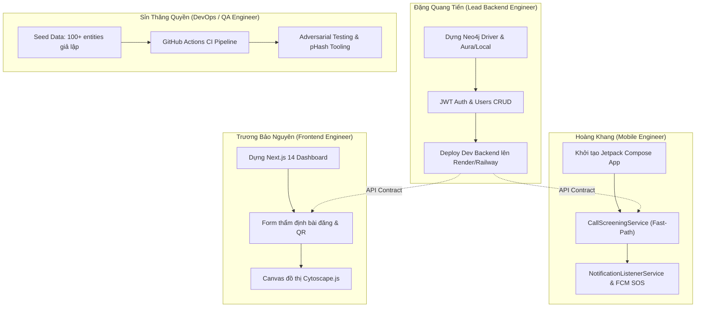

# SMARTGUARD — ACTIONABLE SPRINT 1 GUIDE & TASK CHECKLIST

> **Dự án:** SmartGuard — Hệ thống kiểm chứng & cảnh báo lừa đảo trực tuyến  
> **Nhóm thực hiện:** Nhóm 03 — Lớp 24_31 (FIT, HCMUS)  
> **Kiến trúc:** FastAPI (Backend) • Android Kotlin (Mobile) • Next.js (Web) • Neo4j & PostgreSQL (DB)  
> **Trạng thái lõi AI hiện tại:** 25/25 Automated Unit & Integration Tests **PASSED** (0.48s)

---

## 1. Trạng thái hoàn thành của Lõi AI (Core Verification Engine)

Hệ thống đã được thiết kế và hiện thực hóa thành công kiến trúc phân tầng 2 lớp theo chuẩn Clean Architecture:

```
[Incoming Request]
       │
       ├──► FAST-PATH (<100ms) ────────► [CallScreening / Tra cứu nhanh]
       │    └── GraphService.query_entity_risk + ScoringService
       │
       └──► DEEP-PATH (Phân tích sâu) ──► [Web Audit / Bài đăng đa kênh]
            ├── VisionService: Bóc tách Napas VietQR TLV + So khớp pHash 64-bit
            ├── NLPService: Nhận diện thao túng tâm lý (PhoBERT/Gemini Fallback)
            └── GraphService: Khám phá liên kết đa bước k <= 3 trong Neo4j
```

Các endpoints sẵn sàng phục vụ tại `http://localhost:8000/api/v1/`:
- `POST /verify/entity`: Kiểm tra nhanh số điện thoại hoặc tài khoản ngân hàng.
- `POST /verify/vietqr`: Bóc tách chuỗi mã VietQR Napas (BIN, số tài khoản, số tiền, nội dung).
- `POST /verify/image-phash`: So khớp mã băm ảnh phòng trọ/tuyển dụng với kho dữ liệu lừa đảo.
- `POST /verify/post`: Thẩm định toàn diện bài đăng đa kênh (kết hợp cả 4 chiều phân tích).

---

## 2. Bảng phân công chi tiết & Checklist cho từng thành viên



---

### Thành viên 1: Đặng Quang Tiến (24120149) — Lead Backend Engineer
* **Trọng tâm:** Điều phối kiến trúc, tích hợp cơ sở dữ liệu Neo4j thực tế, hoàn thiện phân hệ Auth và Deploy bản Dev Backend để giải phóng cho Mobile và Web kết nối.
* **Checklist công việc:**
  - [ ] **Kết nối Neo4j thực tế:**
    - Cấu hình file `backend/app/core/config.py` đọc biến môi trường `NEO4J_URI`, `NEO4J_USER`, `NEO4J_PASSWORD`.
    - Thay thế mock instance trong `GraphService` bằng kết nối Neo4j Driver chính thức khi có cấu hình kết nối.
  - [ ] **Hoàn thiện API Xác thực (Auth Module):**
    - Hiện thực `POST /api/v1/auth/register` và `POST /api/v1/auth/login` cấp mã JWT Bearer Token theo chuẩn `docs/API_CONTRACT.md`.
  - [ ] **Deploy Backend Dev:**
    - Deploy container backend lên nền tảng đám mây miễn phí (Render hoặc Railway) để cung cấp Public HTTPS URL (ví dụ: `https://antiscam-api-dev.onrender.com`).
    - Cập nhật URL công khai vào nhóm chat cho Khang và Nguyên kết nối từ xa.

---

### Thành viên 2: Hoàng Khang (24120334) — Mobile Engineer
* **Trọng tâm:** Ứng dụng Android Native (Kotlin + Jetpack Compose) bảo vệ người cao tuổi và sinh viên, phản hồi siêu tốc trước khi đổ chuông.
* **Checklist công việc:**
  - [ ] **Khởi tạo Project Android Studio:**
    - Thiết lập dự án Android với Kotlin, Jetpack Compose, Retrofit 2 (hoặc Ktor Client), MinSDK 26, TargetSDK 34.
  - [ ] **Hiện thực `CallScreeningService`:**
    - Đăng ký service trong `AndroidManifest.xml` với quyền `android.permission.BIND_SCREENING_SERVICE`.
    - Khi nhận cuộc gọi đến từ số ngoài danh bạ: Trích xuất số điện thoại, gọi ngay Fast-Path endpoint `POST /api/v1/verify/entity` (budget < 500ms).
    - Nếu `risk_level == "CRITICAL"`: Thực hiện `respondToCall(CallResponse.Builder().setDisallowCall(true).setRejectCall(true).build())` và kích hoạt rung cảnh báo.
  - [ ] **Hiện thực `NotificationListenerService`:**
    - Lắng nghe thông báo từ ứng dụng Zalo, Messenger, SMS.
    - Dùng biểu thức chính quy (Regex) quét chuỗi có cấu trúc số tài khoản (9-16 chữ số) hoặc số điện thoại; tuyệt đối không đọc nội dung riêng tư.
  - [ ] **Tích hợp Firebase Cloud Messaging (FCM):**
    - Nhận token thiết bị và gửi về server để đăng ký nhận cảnh báo SOS gia đình khi người thân gặp nguy hiểm.

---

### Thành viên 3: Trương Bảo Nguyên (24120397) — Frontend Engineer
* **Trọng tâm:** Web App Next.js 14 với canvas trực quan hóa mạng lưới đồ thị liên kết đối tượng lừa đảo cho người dùng và điều tra viên.
* **Checklist công việc:**
  - [ ] **Khởi tạo Web Client (Next.js 14):**
    - Cài đặt Next.js App Router, Tailwind CSS, Lucide React, Axios.
  - [ ] **Giao diện Thẩm định bài đăng đa kênh (`/verify`):**
    - Xây dựng form cho phép dán nội dung bài đăng Facebook/Zalo, quét ảnh mã QR VietQR và đính kèm ảnh phòng trọ.
    - Gọi endpoint `POST /api/v1/verify/post` và hiển thị đồng hồ điểm tín nhiệm (Credit Score Meter: Xanh / Vàng / Cam / Đỏ).
    - Hiển thị danh sách kịch bản giả định What-If do AI sinh ra.
  - [ ] **Trực quan hóa đồ thị tri thức với Cytoscape.js (`/graph`):**
    - Tích hợp thư viện `cytoscape` và `cytoscape-cola` hoặc `cose-bilkent`.
    - Vẽ các nút (Nodes) theo màu: Nút số điện thoại (Xanh lam), Nút tài khoản ngân hàng (Vàng), Nút báo cáo lừa đảo (Đỏ).
    - Vẽ các cạnh (Edges): `LINKED_TO`, `TRANSFERRED_TO`, `REPORTED_FOR`.
    - Hỗ trợ click vào từng nút để xem thông tin chi tiết và mức phạt tín nhiệm.

---

### Thành viên 4: Sỉn Thăng Quyền (24120425) — DevOps / QA Engineer
* **Trọng tâm:** Quản trị dữ liệu kiểm thử (Golden Dataset), hoàn thiện công cụ xử lý ảnh và thiết lập hệ thống tự động hóa kiểm thử (CI/CD Quality Gate).
* **Checklist công việc:**
  - [ ] **Mở rộng kịch bản sinh dữ liệu mẫu (`scripts/seed_data.py`):**
    - Viết script nạp dữ liệu mẫu chất lượng cao:
      - 50 số điện thoại lừa đảo đã xác minh kèm kịch bản chi tiết.
      - 50 tài khoản ngân hàng liên kết thành 3 đường dây (Syndicate clusters).
      - 20 cặp ảnh phòng trọ mẫu kèm mã băm 64-bit pHash.
  - [ ] **Tự động hóa CI/CD trên GitHub Actions:**
    - Tạo file `.github/workflows/ci.yml`: Chạy `pytest backend/tests/` tự động trên mỗi commit và Pull Request.
    - Chặn việc merge vào nhánh `main` nếu bất kỳ test nào trong bộ 25 test bị fail.
  - [ ] **Công cụ tính mã băm tri giác ảnh (pHash Tooling):**
    - Viết helper script bằng Python (sử dụng Pillow + DCT) cho phép người dùng/admin upload ảnh từ web và tự động sinh mã băm 16 ký tự hex để lưu vào database.

---

## 3. Quy trình phối hợp kỹ thuật & Kiểm soát phiên bản (Agile & GitFlow)

Để 4 thành viên phát triển tính năng song song, liên tục tích hợp mà không xảy ra xung đột mã nguồn (merge conflicts):

1. **Nguyên tắc phân ranh giới module (Modular Seams & Loose Coupling):**
   - Đảm bảo tính độc lập tối đa giữa các tầng kiến trúc. Mỗi thành viên chịu trách nhiệm chính trên phân hệ của mình (`backend/`, `mobile/`, `web/`, `scripts/`).
   - Giao tiếp liên phân hệ bắt buộc tuân thủ giao ước tại `docs/API_CONTRACT.md`.
2. **Quy tắc phân nhánh Git (GitFlow rút gọn):**
   ```bash
   # Nhánh tính năng cho Android Native:
   git checkout -b feature/module-d-call-screening
   # Nhánh tính năng cho Frontend Web:
   git checkout -b feature/module-c-cytoscape-graph
   # Nhánh hạ tầng & CI/CD:
   git checkout -b feature/devops-github-actions
   # Nhánh lõi backend & Neo4j:
   git checkout -b feature/module-b-neo4j-driver
   ```
3. **Quy trình kiểm duyệt Pull Request (Code Review & Quality Gate):**
   - Mỗi Pull Request chỉ giải quyết một đơn vị công việc (Task/User Story) cụ thể.
   - Bắt buộc kiểm thử cục bộ đạt 100% trước khi tạo Pull Request:
     ```bash
     python -m pytest backend/tests/ -v
     ```
   - Pipeline GitHub Actions CI phải hoàn thành màu xanh (Pass toàn bộ 25 bài test tự động) trước khi Tech Lead duyệt merge vào nhánh `develop`.
